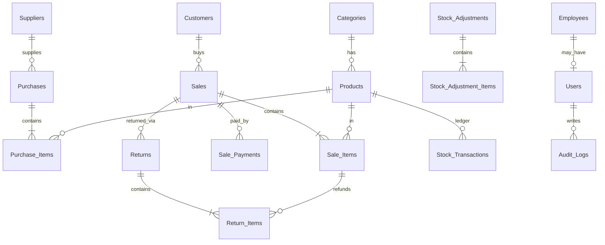

# Smart Inventory & Billing Management System

Flask + MySQL 8 retail ERP: POS billing with GST, purchases, stock ledger, returns, reports, role-based access.
Runs locally on Windows. Uses your **existing** `smart_inventory_billing` database and never drops or alters the 5 master tables.

## Status (read this first)
Tested: 17 automated tests on **SQLite** (billing, GST, ledger, returns, adjustments, roles, every page and report export) plus the demo seeder.
**Not yet tested against a real MySQL server** (none was available while building). Do steps 1-8 below and run `pytest` once on your machine.
Not built yet: barcode display, logo upload (settings stores text only), employee-to-login linking UI (create more users via a small script), Alembic migrations (uses `flask init-db`, which only adds missing tables).

## Features
Login/logout, change password, 4 roles | Dashboard with live KPIs and 4 charts | CRUD: categories, products, suppliers, customers, employees, expenses (search, pagination, sorting, filters) |
POS with split payments, GST (CGST+SGST or IGST by customer state), bill discount, A4 + thermal print, PDF | Purchases | Stock ledger (source of truth) + adjustments |
Cancel invoice, returns (resalable restocked, damaged not) | 13 reports with CSV / Excel / PDF / print | Store settings | Audit log.

## Rules enforced
- Only `services/stock.py::post_txn` changes `Products.stock_quantity`; every change writes a ledger row with running balance.
- Negative stock is rejected; the whole sale rolls back (single DB transaction, row lock on products).
- Duplicate submit protection through a per-cart idempotency key + unique invoice/purchase numbers.
- Money is `DECIMAL(12,2)`. Bill discount is split across lines; GST is computed after discount; total is rounded to the rupee (round-off stored).
- Profit = (taxable sales - returns) - (cost of goods sold - cost of resalable returns) - expenses. GST is never revenue. Cost uses the cost price snapshot saved on each sale line.
- GST report: output CGST/SGST/IGST minus GST on returns, minus input GST on purchases.

## Architecture
`app/models` (SQLAlchemy) -> `app/services` (business rules) -> `app/routes` (Flask blueprints) -> `app/templates` (Jinja + Bootstrap 5 + Chart.js).



## Windows setup
1. Install Python 3.11+ and MySQL 8 (with MySQL Workbench).
2. In Workbench confirm database `smart_inventory_billing` exists with your 105 master rows (10 categories, 10 suppliers, 30 customers, 5 employees, 50 products). If not, run your Phase 3 Part 1 script first. It is not included here.
3. Open PowerShell in the project folder:
```powershell
python -m venv venv
venv\Scripts\activate
pip install -r requirements.txt
copy .env.example .env
```
4. Edit `.env`: set `DB_PASSWORD`, a long `SECRET_KEY`, and `ADMIN_PASSWORD`.
5. Create the missing tables (existing tables untouched):
```powershell
set FLASK_APP=run.py
flask init-db
```
(Or run `database/schema.sql` in Workbench. It uses `IF NOT EXISTS`.)
6. Create the admin and align the ledger with existing stock:
```powershell
flask seed-admin
flask sync-ledger
```
7. Optional demo data (skips itself if sales or purchases already exist): `python database/seed_demo_data.py`
8. Run: `python run.py` then open http://127.0.0.1:5000 and sign in with `ADMIN_EMAIL` / `ADMIN_PASSWORD` from `.env`.
9. Tests: `python -m pytest -q tests` (uses in-memory SQLite, does not touch MySQL).

## Using the modules
- **POS**: search or tap products, pick a customer (needed for credit or B2B), enter discount and payment, Complete sale. Invoice opens with Print / PDF / Thermal.
- **Purchases**: New purchase -> supplier, products, qty, cost. Stock increases and ledger rows are written.
- **Inventory**: ledger with filters; Stock Adjustments for opening, increase, decrease, damaged, expired, correction (signed).
- **Returns**: open an invoice -> Return items. Cancel is only for completed invoices with no returns.
- **Reports**: pick report and filters, then export.

## Roles
Admin: everything. Manager: sales, purchases, products, inventory, customers, reports, expenses. Cashier: POS, sales, returns, customers. Inventory Clerk: products, categories, stock, suppliers, purchases, adjustments.

## Common errors
- `Can't connect to MySQL server`: MySQL service not running, or wrong `DB_*` values in `.env`.
- `Access denied for user`: wrong `DB_PASSWORD`.
- `Unknown database`: create it in Workbench: `CREATE DATABASE smart_inventory_billing;`
- `cryptography` error with MySQL 8 login: `pip install cryptography` (already in requirements).
- Ledger mismatch warning on Inventory page: run `flask sync-ledger` once.
